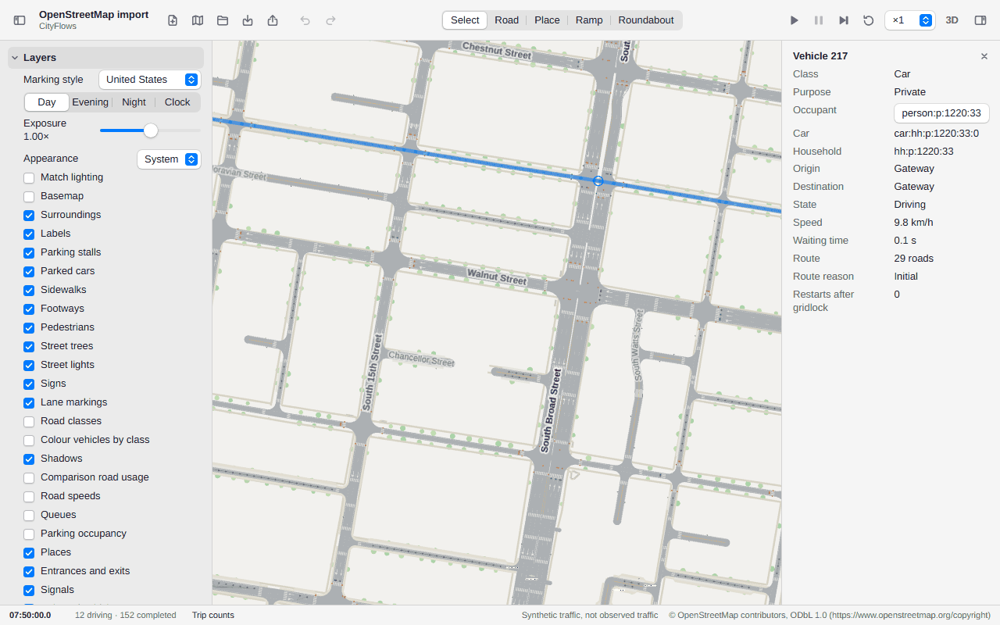
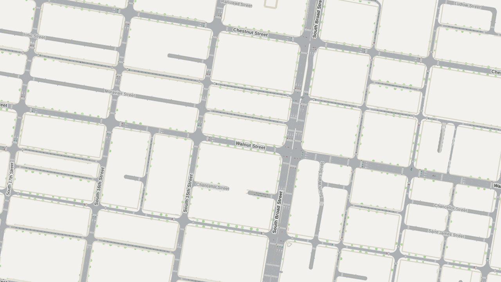
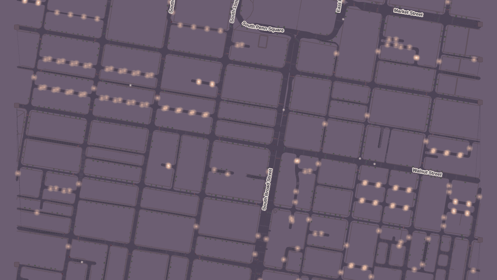
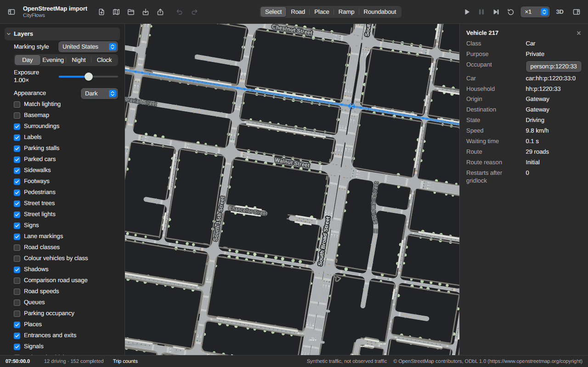
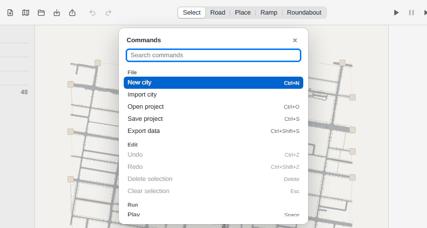

# CityFlows

## Use it

[Open CityFlows on GitHub Pages](https://chengxuan-li.github.io/cityflows/).

CityFlows is a traffic sandbox that runs in your browser. Cars, walkers and trams travel between
homes and workplaces on lane-level streets you draw or import from OpenStreetMap. You can change
streets and signals and see how the same commute plays out on the edited network.



- The 5 × 5 grid opens by default. You can also choose a city from **New**. Press **Play**, pick
  a speed, and click a moving car to inspect its route. On a first visit a few hints point at each
  step; **Show hints** in the empty inspector brings them back.
- While the simulation runs, select a street to edit its lanes or a junction to edit its signal
  phases.
- To try a real city, choose **Import** → **Choose map area**, then Shift-drag to select an area
  up to 50 km². You can also upload an `.osm` file.
- For a before-and-after comparison, open **Compare** and select **Save as baseline**. Make an
  edit, then return to **Compare** and select **Run comparison** to see how travel times and trip
  counts changed.
- Use **Export** to download the street network as GeoJSON or the simulation results as CSV. Use
  **Save** to download a project you can reopen later.

**Synthetic traffic, not observed traffic.** Imported map data is credited to
[© OpenStreetMap contributors](https://www.openstreetmap.org/copyright).

### The window

The toolbar holds the file actions, undo and redo, the tools (Select, Road, Place, Ramp,
Roundabout), the run controls, speed and 3D. The left sidebar has a collapsible section for the
active tool's options, **Layers**, **Chart**, **Demand**, **Compare** and **Validation**; the right
inspector shows the selected car, street, junction, place, person or train. The status bar shows
the clock and trip counts. Both sidebars hide from the toolbar and resize by their inner edge.
In a narrow window they float over the map and the toolbar moves what does not fit into the
**»** menu.

### Look of the map

- **Map.** A plain canvas with white roads; vehicles take a colour by destination, or by class
  with **Colour vehicles by class**. In an imported city, **Basemap** adds OpenStreetMap tiles.
- **Labels.** Street names follow the road and show where the street is wide enough on screen;
  stations, tram stops and places carry names too. The **Labels** layer switches them off. They
  are drawn in 2D.



- **Time of day.** In **Layers**, **Day**, **Evening** and **Night** change the light in 2D and
  3D: street lamps, lit windows, head- and tail-lamps and signal heads switch on after dark.
  **Clock** follows the simulation clock, and its **Season** (Summer, Spring/autumn, Winter) sets
  sunrise and sunset: in Winter dusk falls at 16:20, so a run reaches the evening. **Exposure**
  brightens or darkens the scene; double-click it to reset. The setting belongs to your browser,
  not to the project, and does not change the simulation.



- **Appearance.** In **Layers**, **Appearance** is System, Light or Dark. **Match lighting**
  switches the window to dark at Evening, Night or after dusk. The dark map darkens the canvas
  and place tints only; roads, markings, rail and vehicles keep their colours.



- **Marking style.** Germany, United States or United Kingdom markings. Crosswalks and the mouths
  of car parks and garages carry a keep-clear marking (a hatched box, or a KEEP CLEAR stencil),
  and queued cars stop short of it.

### Keys and the command menu

Press **Ctrl+K** (**⌘K** on a Mac) to open the command menu: type to find any action, press
Enter to run it, and its key is listed beside it. **Ctrl+/** or **?** lists every shortcut.



| Key                  | Action                                     |
| -------------------- | ------------------------------------------ |
| Space                | Play or pause (hold Space and drag to pan) |
| `.`                  | Step                                       |
| Ctrl+R               | Restart                                    |
| `[` and `]`          | Slower and faster                          |
| 1 to 5               | Select, Road, Place, Ramp, Roundabout      |
| V or Ctrl+3          | Switch between 2D and 3D                   |
| Ctrl+1, Ctrl+2       | Hide or show the sidebar, the inspector    |
| Esc                  | Clear the selection                        |
| Delete               | Delete the selected street or place        |
| Ctrl+Z, Ctrl+Shift+Z | Undo, redo                                 |
| Ctrl+N, O, S         | New city, open a project, save             |
| Ctrl+Shift+S         | Export                                     |

On a Mac, read Ctrl as ⌘. Keys do nothing while you type in a field or while a sheet is open. A
browser may keep Ctrl+N (and sometimes Ctrl+1 to 3) for itself; the command menu runs those too.

### Signals

Select a junction with signals to edit its phases, amber, all-red and offset. **Actuated** ends a
green early when no one is waiting; generated signals start actuated. **Split green by demand**
shares the cycle between phases by the demand the run expects, and is off until you switch it on.
**Right turn on red** (left in left-hand traffic) is a switch too.

### People and how they travel

- **Households.** Each household owns cars that its members share. A person leaves in a car only
  if the household has one free that day; click a car and its **Household** lists the members,
  and a person's inspector shows **Car today**.
- **Mode choice.** In **Demand**, the **Choose walk, car or transit** switch lets each person
  choose, at each departure, between walking, driving and, where the city has a tram or S-Bahn,
  riding it. **Walk preference**, **Value of time**, **Car cost** and **Cost sensitivity** tune
  the choice. Changes apply at the next **Restart**. **Chart** shows the mode shares by hour.
- **Transit.** A rider walks to the stop, waits, boards the first tram or S-Bahn with room, rides
  and walks on, giving up after 30 minutes. Click a train to see **Riders** against its places
  and to select a rider. **Chart** lists the riders per line and trips left behind by a full
  vehicle.
- **Station riders.** In an imported city with S-Bahn stations, such as Munich's
  Donnersbergerbrücke (upload [`fixtures/osm/munich-donnersberger.osm`](fixtures/osm/munich-donnersberger.osm)
  under **Import**), people ride in with the trains, walk out of the station to work or a visit
  nearby, and walk back to board.

## Run it

```
npm ci
npm run dev
```

Open the printed URL. The bundled 5 by 5 grid loads with a morning commute scheduled; press
Play, pick a speed, click a car, a street or a junction, change a lane count, a one-way, a
turn or a signal phase, then Restart to replay the same demand on the edited network.

```
npm run check      # typecheck, lint, format check, unit tests, build
npm run test:e2e   # Playwright scenarios (first: npx playwright install chromium)
```

## Where things are

`docs/architecture.md` holds the contracts (data model, compile, routing, simulation,
project format); `docs/plan.md` the delivery gates and task graph; `AGENTS.md` the rules for
working on the code.

## License and data

GPL-3.0-or-later; see `LICENSE` and `NOTICE`. Imported map data is from OpenStreetMap
contributors under the ODbL (https://www.openstreetmap.org/copyright); every imported project
carries that attribution.
