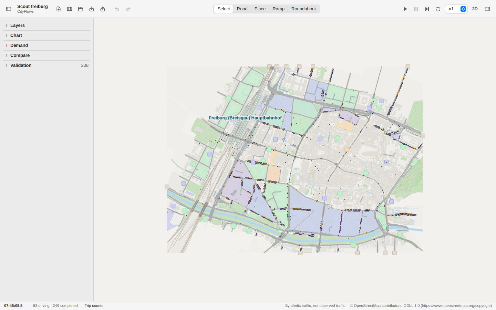
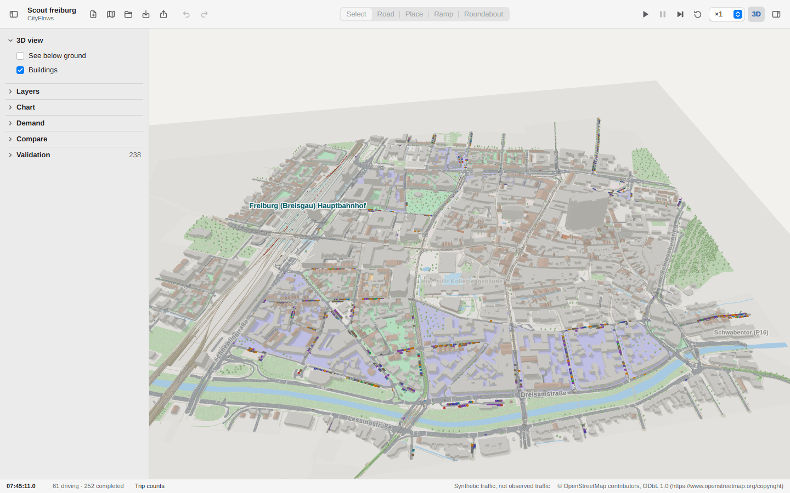
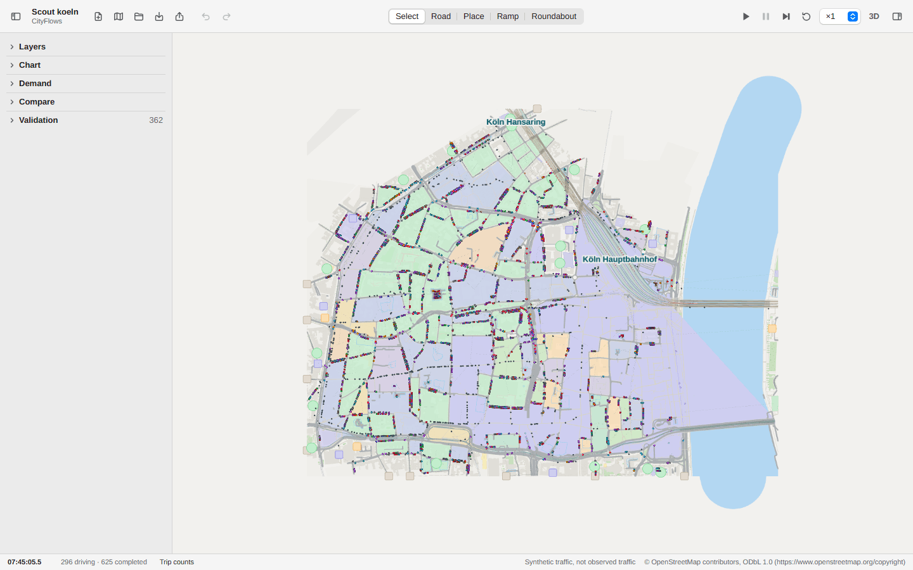
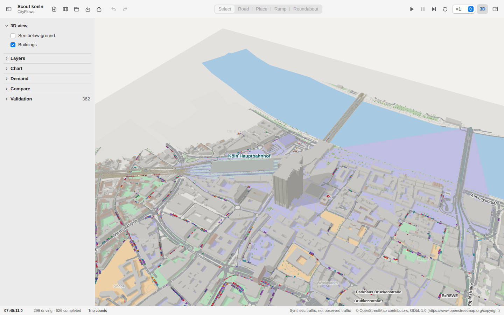
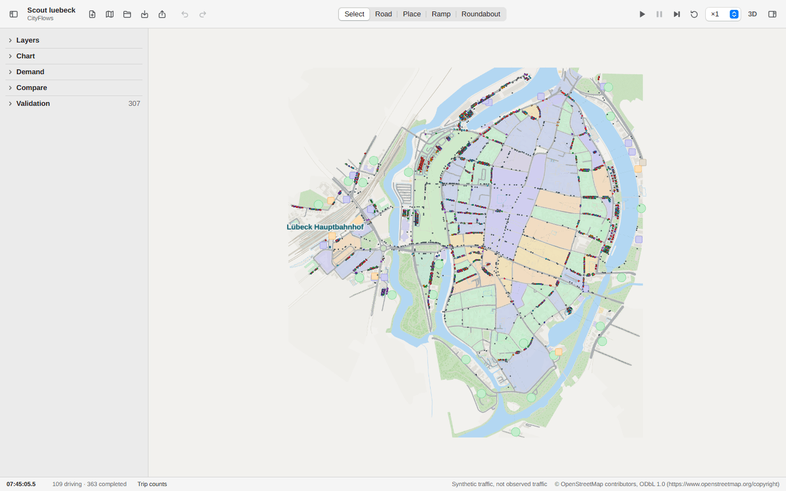
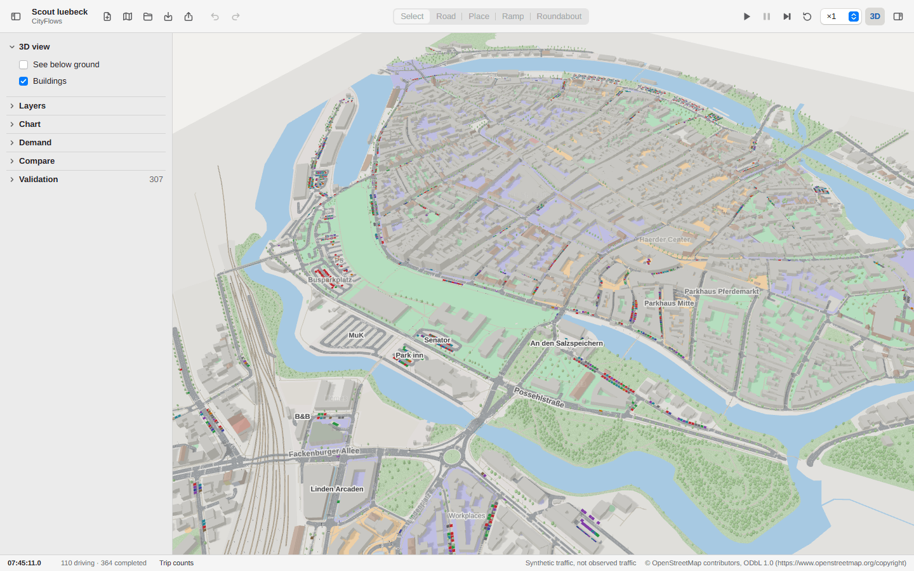
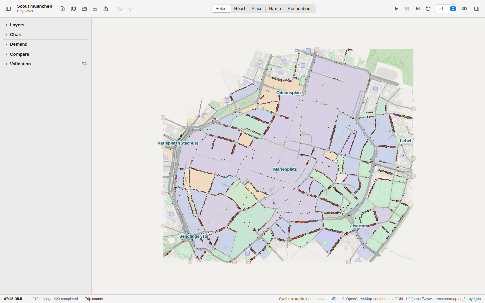
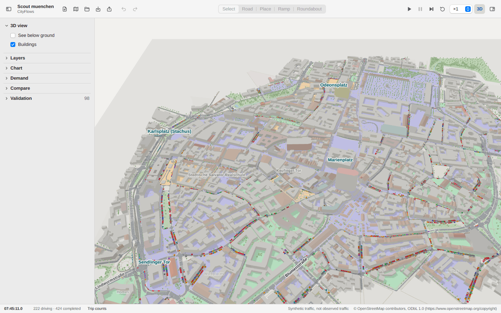

# Decision: the landing city

Raised by the owner, 2026-11-17 (TASK-197 scouts, TASK-198 builds).

## Context

The app opens on the 5 x 5 grid. The owner wants the landing view to be a showcase: a curated, stable
version of a real German place, richer rather than small, cut along a natural edge (river, rail line,
ring road, old wall) rather than a square, and not necessarily busy when it opens. TASK-197 fetched a
polygon extract for four places, imported each with the existing importer (no source changes), ran
each headless and in a production build, and took 2D and 3D shots. This document records what each
place gives, what the importer cannot do yet, and what TASK-198 must build.

## Candidates

Each polygon follows the edge named, about 30 to 150 m outside it so the edge itself is inside. The
importer only takes a bbox, so every import used the polygon's bounding box (see "What the importer
cannot do").

|                      | Polygon                         | Edge                                                                                                                                                                                       | Polygon / bbox  |
| -------------------- | ------------------------------- | ------------------------------------------------------------------------------------------------------------------------------------------------------------------------------------------ | --------------- |
| Freiburg im Breisgau | Altstadt and Hauptbahnhof       | rail line and Hbf west, Friedrichring north, Leopoldring and Schlossbergring east (Schlossberg beyond), Dreisam south                                                                      | 1.62 / 2.28 km² |
| Köln                 | Altstadt-Nord inside the Ring   | Hohenzollernring, Kaiser-Wilhelm-Ring and Hansaring west and north, the rail viaduct into the Hbf north-east, the Rhine east (east bank, so both bridges are inside), Cäcilienstraße south | 2.75 / 3.66 km² |
| Lübeck               | the Altstadt island and the Hbf | the Trave west and north, the Elbe-Lübeck canal east, the rail line past the Hbf west                                                                                                      | 2.70 / 4.74 km² |
| München              | inside the Altstadtring         | Sonnenstraße, Oskar-von-Miller-Ring, Franz-Josef-Strauß-Ring, Thomas-Wimmer-Ring and Blumenstraße; east to Maximilianstraße's roundabout, not the Isar                                     | 2.18 / 2.81 km² |

The Munich fixture (`munich-donnersberger.osm`, a 2.15 km² bbox) is the size reference throughout.

## Measurements

Headless numbers (import, compile, step, gates) come from scratch scripts that call the repository's
own `importOsm`, `compile`, `auditJunctions` and `probeMorning` (`bench/import-probe.ts`), the same
morning the traffic gate runs: 07:00 to 10:00 at 0.15 persons per resident. Browser numbers come from
`vite build` bundles served by `vite preview` on ports 5398 and 5498: load time from the production
bundle (MODE=production, no test API), frame and in-app step times from the test-mode bundle (the
same optimised bundle with the test API, as the e2e harness uses), Chromium with the GPU
(RTX 4070 SUPER, ANGLE D3D11), 1440 x 900 at device scale 1, inspector hidden. Frame interval is the
`requestAnimationFrame` interval while playing at 1x from 07:45 with continuous rendering on (it
pins at the 60 Hz display); render CPU is the `cityflows:render` / `cityflows:render3d` measure. The
CPU load column is the machine's load when the step began (28 logical cores); see "Numbers taken
under load".

|                                                          | Freiburg                               | Köln                                     | Lübeck                                   | München Altstadtring                     | Munich fixture (reference)             |
| -------------------------------------------------------- | -------------------------------------- | ---------------------------------------- | ---------------------------------------- | ---------------------------------------- | -------------------------------------- |
| OSM extract (MB)                                         | 6.0                                    | 8.6                                      | 6.3                                      | 5.6                                      | 3.6                                    |
| Import cold / warm (s)                                   | 12.5 / 12.2                            | 34.4 / 32.4                              | 21.7 / 19.9                              | 16.0 / 15.5                              | 10.1 / 10.9                            |
| Compile (s)                                              | 1.6                                    | 4.1                                      | 2.3                                      | 3.3                                      | 1.4                                    |
| CPU load at import (%)                                   | 10 to 30                               | 11 to 12                                 | 11 to 17                                 | 23 to 1                                  | 47 to 0                                |
| Nodes / roads / lanes / movements                        | 857 / 1322 / 1889 / 2472               | 1474 / 2334 / 3012 / 4029                | 926 / 1738 / 1892 / 2726                 | 631 / 1138 / 1543 / 2196                 | 470 / 886 / 1090 / 1727                |
| Road km (outside polygon)                                | 47 (3.9)                               | 77 (2.9)                                 | 80 (5.5)                                 | 61 (3.9)                                 | 55 (0.0)                               |
| Signals / junction groups                                | 102 / 45                               | 203 / 105                                | 65 / 54                                  | 84 / 55                                  | 26 / 39                                |
| Walk links / parking spaces                              | 19013 / 1812                           | 34831 / 3468                             | 17532 / 4018                             | 34837 / 3533                             | 11857 / 2847                           |
| Buildings                                                | 2782                                   | 4868                                     | 5179                                     | 2111                                     | 1406                                   |
| Rail track km by kind                                    | rail 12.7, tram 10.1                   | light_rail 18.3, rail 17.2               | rail 10.2                                | rail 4.3, subway 10.4, tram 12.5         | rail 62.2, tram 5.8                    |
| Tram stops / platforms                                   | 34 / 63                                | 0 / 83                                   | 0 / 106                                  | 33 / 88                                  | 14 / 30                                |
| Train routes, departures per hour                        | 5, 75                                  | 10, 125                                  | 2, 20                                    | 10, 120                                  | 20, 210                                |
| Tram routes, departures per hour                         | 0 (10.1 km of track)                   | none (no tram track)                     | none (no tram track)                     | 7, 70                                    | 4, 40                                  |
| Bridge / tunnel roads                                    | 24 / 71                                | 4 / 119                                  | 32 / 45                                  | 2 / 32                                   | 28 / 30                                |
| City JSON (MB) / gzip (MB)                               | 6.3 / 1.2                              | 11.4 / 2.3                               | 8.7 / 1.6                                | 9.5 / 1.9                                | 4.5 / 0.8                              |
| Gateways (at bbox edge) / OSM roads crossing the polygon | 12 (12) / 59                           | 10 (10) / 75                             | 1 (1) / 49                               | 12 (12) / 66                             | 33 (33) / 60                           |
| Production: page load, open project to first frame (s)   | 0.9, 10.9 (CPU 2%); 0.5, 10.6 (CPU 7%) | 0.7, 45.7 (CPU 42%); 0.7, 40.4 (CPU 20%) | 0.6, 19.3 (CPU 19%); 0.6, 19.3 (CPU 22%) | 0.7, 18.7 (CPU 50%); 0.6, 18.3 (CPU 46%) | 0.6, 8.3 (CPU 25%); 0.6, 7.9 (CPU 28%) |
| Frame 2D: interval / render CPU (ms)                     | 16.7 / 0.59 (p95 1.5)                  | 16.7 / 1.15 (p95 3.1)                    | 16.7 / 0.62 (p95 2.1)                    | 16.7 / 0.85 (p95 2.2)                    | 16.7 / 0.48 (p95 1.4)                  |
| Frame 3D: interval / render CPU (ms)                     | 16.7 / 1.25 (p95 1.5)                  | 16.7 / 2.10 (p95 2.3)                    | 16.7 / 1.10 (p95 1.6)                    | 16.7 / 1.94 (p95 2.2)                    | 16.7 / 1.43 (p95 2.3)                  |
| 3D scene build (s)                                       | 4.3                                    | 28.5                                     | 9.4                                      | 5.8                                      | 3.8                                    |
| In-app step, 07:00 to 07:45 (ms per 0.1 s step)          | 0.17                                   | 1.29                                     | 0.24                                     | 0.46                                     | 0.21                                   |
| Headless step, 07:00 to 10:00, choice on (ms per step)   | 0.18 (CPU 30 to 21%)                   | 1.17 (CPU 10 to 24%)                     | 0.20 (CPU 19 to 36%)                     | 0.73 (CPU 7 to 16%)                      | 0.20 (CPU 0 to 41%)                    |

## Gates at the showcase demand

The showcase demand is the import default, 0.15 persons per resident with mode choice on: what the
landing view would show and run. "Choice off" is the traffic gate's convention (every driver drives)
and is reported as a stress reference. The TASK-154 drain criterion is generalised from the
Landsberger loop to every road: the most wait any single visit to one road added, against 900 s.
The traffic gate also requires every failure to be a gridlock or a counted parking failure;
`no_route` failures break that rule.

|                                                    | Freiburg              | Köln                   | Lübeck                 | München Altstadtring     | Munich fixture (reference) |
| -------------------------------------------------- | --------------------- | ---------------------- | ---------------------- | ------------------------ | -------------------------- |
| Choice on: persons, completed by 10:00             | 3881, 1051            | 9440, 2982             | 6697, 1592             | 8657, 1880               | 5313, 2554                 |
| Choice on: gridlocked / stalled / worst visit (s)  | 0 / 0 / 314           | 0 / 0 / 1514 (fails)   | 0 / 0 / 759            | 82 / 6 / 10011 (fails)   | 0 / 0 / 433                |
| Choice on: other failures                          | no_route 7            | no_route 9             | no_route 121           | none                     | none                       |
| Choice on: no parking share, mean delay (s)        | 1.9%, 238             | 1.1%, 600              | 1.8%, 285              | 0.0%, 791                | 0.0%, 117                  |
| Choice off: persons, completed by 10:00            | 3881, 2645            | 9440, 3725             | 6697, 3513             | 8657, 3522               | 5313, 5308                 |
| Choice off: gridlocked / stalled / worst visit (s) | 30 / 1 / 5169 (fails) | 251 / 2 / 5993 (fails) | 181 / 4 / 9267 (fails) | 143 / 10 / 10272 (fails) | 0 / 0 / 1700 (fails)       |
| Choice off: other failures                         | no_route 7            | no_route 8             | no_route 101           | none                     | none                       |
| Choice off: no parking share, mean delay (s)       | 0.6%, 1272            | 0.7%, 1903             | 0.8%, 1217             | 0.0%, 1629               | 0.0%, 765                  |

Read with the Munich fixture as calibration: it passes its own traffic gate at choice off (5,308
completed against the 5,298 baseline, no gridlock, no stalled head) yet a single visit to r:371 adds
1,700 s, so the all-roads drain figure is stricter than TASK-154's loop criterion and a choice-off
failure here is not unusual. At the showcase demand the fixture's worst visit is 433 s. Freiburg
(314 s) is the only candidate under that; Lübeck passes (759 s) with 121 `no_route` failures; Köln
fails the drain (1,514 s on Victoriastraße, r:2091, OSM way 147726287); München gridlocks (82
trips, 6 stalled heads, a 10,011 s visit on r:1585, OSM ways 27630586 and 315220260).

## Screenshots

Light appearance, Day lighting, production-optimised bundle, at 07:45 after stepping from 07:00. No
basemap: requests off the machine were blocked, so the map is the app's own drawing. 2D is the
fitted view the city opens on; 3D is a showcase camera (pitch 45°). The full set (07:00 2D, zoomed
2D, close 3D) is outside the repository.

Freiburg: 


The 2D view is the bbox, not the polygon: the Dreisam, the rail line and the ring sit inside a square
of way tails ending in bbox gateways. In 3D the Münster is the tall grey block right of centre; the
Schlossberg's forest is top right, flat.

Köln: 


The Rhine overshoots the bbox as a round-ended stroke; the lilac triangle is the 0.53 km² core block
(finding 9); the Dom is the 157 m block south of the Hbf, beside the Hohenzollernbrücke.

Lübeck: 


The island reads at once in both views; the land-use fringe still stops at the bbox.

München: 


The ring is clear in 2D; most of the core is one pedestrian-zone block, and its edges carry the queues
seen at 07:45.

## What the importer cannot do

1. **Polygon boundaries.** `ImportOptions` has only `bbox`, and `clip.ts`, `context.ts`, buildings,
   rail, walk and parking all clip to that rectangle. An Overpass `poly:` extract has no `<bounds>`, and
   Overpass returns every way that touches the polygon whole, so the city keeps way tails beyond the
   edge (road km outside the polygon: Freiburg 3.9, Köln 2.9, Lübeck 5.5, München 3.9) and the 2D view
   shows the bbox rectangle with a ragged fringe, not the river or the ring. Land use and water are
   clipped to the bbox too: Köln's Rhine is drawn from its centreline (`waterway=river` way 1226739901) with round ends that overshoot the bbox north and south (Köln 2D shot).
2. **Entry points at the edge.** `addGateways` (`places.ts`) only makes gateways at road ends cut by
   the bbox. The drivable OSM ways that really cross each polygon, and the gateways the import made:
   Freiburg 59 crossing (22 tertiary or above) against 12 gateways, all on the bbox edge, on side
   streets (Falkensteinstraße, Hildastraße, Kirchstraße) rather than the real entries (B 31
   Schwarzwaldstraße way 242170278, Leo-Wohleb-Straße 10209572, Habsburgerstraße 30313858, Kronenstraße
   239527135, Günterstalstraße 4099150, Breisacher Straße 23024406); Köln 75 (24) against 10 (none at
   Deutzer Brücke 49601865 or Hansaring 99156553); Lübeck 49 (20) against **1** (Falkenstraße, outside
   the island: 36 cars entered, none left), so none of the island's bridges (Holstenbrücke 25288784,
   Puppenbrücke 4426585, Marienbrücke 25489129, Hüxtertorbrücke 25288340, Burgtorbrücke 4228255,
   Mühlenbrücke 4426573, Drehbrücke 150345351) is an entry; München 66 (28) against 12.
3. **Disconnected tails.** The tails beyond the edge form fragments with no way back: disconnected lanes
   Freiburg 255, Köln 71, Lübeck 339 (Falkenstraße ways 87694280 and 97948538, across the canal),
   München 11; dead-end lanes 41, 56, 121, 24. Places on them cannot be reached: the `no_route`
   failures in the gate table (Lübeck 121, all unspawned) come from these.
4. **Trains and trams at a polygon edge.** Services start and end only at rail nodes within 0.1 m of
   the bbox (`src/network/rail.ts`, `boundary`). Lübeck's Hbf gets 2 mainline routes because two tracks
   happen to reach the bbox; Freiburg gets 5 S-Bahn routes and **no tram routes** although it imports
   10.1 km of tram track, 34 tram stops and a connected 6.65 km tram network with 5 ends on the bbox
   edge (`buildTimetable(rail, 'tram')` returns none; a likely cause, not verified, is the wrong-way
   share test in `routesFor`); München gets 7 tram and 10 train routes; Köln 10 train routes.
5. **Landmark buildings.** The Overpass query does not fetch `building:part`, and `buildings.ts`
   extrudes a whole footprint to its `height`. Freiburg's Münster (way 110404213, height 116) and the
   Kölner Dom (way 4532022, 157.38; Nordturm 645732604, 157) stand as solid grey blocks the height of
   their spires (both 3D shots); also St. Peter (228534603, 91) and the Theatinerkirche (25514390, 71)
   in München. A showcase needs these curated (parts, or capped heights with a roof).
6. **Terrain.** Not fetched: terrain comes from AWS Terrain Tiles, which this task was not cleared to
   download. It matters for Freiburg only (the Schlossberg rises about 150 m right behind
   Schlossbergring); Köln, Lübeck and München are flat. TASK-198 needs a terrain fixture as
   `fixtures/terrain/munich-donnersberger.json` is made (`bench/terrain-fetch.ts`).
7. **Köln's Stadtbahn.** Its 74 `railway=light_rail` ways (37 in tunnel) import as light-rail track
   (18.3 km, 90 tunnel tracks), but `tram-stops.ts` only takes `kind === 'tram'`, so the 39
   `railway=tram_stop` nodes give no stops and no light-rail service runs.
8. **Building passages read as tunnels.** `osmLayer` (`roads.ts`) puts any `tunnel` other than `no`
   at layer -1, including `tunnel=building_passage`, which `rail.ts` already treats as at grade. In
   Lübeck 18 of the 20 drivable "tunnels" are the Altstadt's building passages (45 roads at layer -1).
9. **Car-free cores become one block.** Pedestrian zones are not roads, so the block between drivable
   roads covers the core: a 0.53 km² place ring shared by four places in Köln (p:5032, p:5038, p:5040,
   p:5096; the lilac triangle running from the Hbf to Deutzer Brücke in the Köln shots) and a
   0.67 km² ring in München. Their demand loads onto the few connectors on the ring's edge.
10. **Smaller gaps.** Unsupported restriction relations (conditional or via-way): Köln 24 (relation
    386637, 445533, 1252274), München 19 (75774, 75996, 1689444); Freiburg 66 `osm_unsupported_tag`
    warnings (`lanes:both_ways=1` on way 30327111 and others); Lübeck `oneway=faux` (119880660,
    150345381). Signals that never serve a movement: Köln n:1538, München n:867 (three movements onto
    r:1805). München: three tram stops with no room for an island (ts:19777, ts:19784, ts:19785).
    Junction geometry is sound in all four: the junction audit finds 0 to 10.6 m² of overlap (worst:
    Lübeck n:1296, OSM node 1475068583, 10.2 m²), no self-intersections, at most 2 escaping
    movements.

## Options

1. **Freiburg**: the most the app can show per km² (main line and Hbf, a tram network with 34 stops,
   the Dreisam with four road bridges (Kronenbrücke, Kaiser-Joseph-Straße, Schwabentorbrücke,
   Greiffeneggbrücke), the Schnewlinbrücke over the tracks, the B 31 and its ramps along the river,
   the Bächle, the Schlossberg once terrain is bundled), the smallest and fastest city, and the
   cleanest gates at the showcase demand. Needs the Münster curated, terrain bundled and the tram
   service fixed.
2. **Lübeck**: the clearest natural edge (an island; every entry is a bridge) and a striking 3D view,
   no trams, flat. Needs polygon gateways most of all (1 gateway today, 121 `no_route` failures),
   and jams badly with every driver driving.
3. **Köln**: the most famous landmarks (Dom, Hbf, Hohenzollernbrücke over the Rhine) but the biggest
   and slowest city, a Dom that needs curating most, a Stadtbahn that runs underground and is not
   modelled, and the drain criterion fails even at the showcase demand.
4. **München inside the Altstadtring**: trams that run (7 routes) and a ring road edge, but most of
   the core is a pedestrian zone, the S-Bahn and U-Bahn are underground, no river inside, and Munich
   is already the city the tests use.

## Recommendation

Option 1, Freiburg. It shows the widest range of what CityFlows models in the smallest city: a
main-line station with five S-Bahn routes, 10 km of tram track through the Altstadt with 34 mapped
stops and catenary masts (the service itself needs the fix below), a river with bridges, a trunk road
with ramps, parking garages, 102 signals and the Bächle, and it has the one real hill of the four. It
is the cheapest of the four to load and run: 12.5 s to import against 16 to 34 s, a 4.3 s 3D build
against 5.8 to 28.5 s, 10.6 to 10.9 s from opening the project to the first frame against 18.3 to
45.7 s, the smallest project file (6.3 MB), and the lowest step cost (0.18 ms, the Munich fixture's
0.20). At the showcase demand it is the only candidate with no gridlock, no stalled head and a worst
visit (314 s) under the Munich fixture's 433 s; its 7 `no_route` failures come from the polygon tails
TASK-198 removes.

Lübeck is the runner-up if the owner prefers the island's edge to Freiburg's features; it needs the
same importer work plus bridge gateways before it runs cleanly, and has no trams. Köln and München
fail the drain criterion at the showcase demand and cost the most to load.

## What TASK-198 must build

For the chosen city (written for Freiburg; the importer items apply to any of the four):

1. **Importer: polygon boundaries.** An `ImportOptions.polygon` (WGS84 ring) that clips roads, rail,
   walk links, parking, buildings, land use and water to the polygon, with the local frame and
   `geo.bbox` from its bounding box. Way tails beyond the edge are cut at the crossing, not kept to
   the way's end, so no disconnected fragment or dead end comes from the cut (Freiburg today: 255
   disconnected lanes, 41 dead ends, 3.9 km of road outside). A test: a polygon import keeps no road,
   track or feature centroid outside the ring, and compiles with no `disconnected_component` from
   the cut.
2. **Importer: gateways and rail portals at polygon crossings.** A gateway where each drivable road of
   tertiary class or above crosses the ring (paired carriageways as `addGateways` pairs them today),
   and rail and tram boundary nodes where tracks cross it, so `src/network/rail.ts` starts services
   there (today only nodes on the bbox edge count). For Freiburg the entries are the B 31 east and
   west (Schwarzwaldstraße, Leo-Wohleb-Straße, Autobahnzubringer Mitte), Habsburgerstraße,
   Stefan-Meier-Straße, Breisacher Straße, Schnewlinstraße, Lessingstraße, Kronenstraße,
   Günterstalstraße and Schlossbergring; the main line north and south; every tram line where it
   leaves the polygon (Habsburgerstraße north, Günterstalstraße and Kronenstraße south, the
   Stadtbahnbrücke and Breisacher Straße west, Schwabentorring east). A test: the gateway set
   equals the curated entry list, and every one carries trips in and out by 10:00.
3. **Trams that run.** Find why `buildTimetable(rail, 'tram')` builds no Freiburg route from a
   connected 6.65 km network with five edge ends (the wrong-way share test in `routesFor` is the first
   suspect) and fix it; trams should run on the main lines through Bertoldsbrunnen.
4. **Curation in the bundled project.** `fixtures/projects/freiburg.cityflows.json` with the polygon
   import, plus: the Münster (way 110404213) as parts or with a capped body height and its spire,
   other spire heights checked (Schwabentor 129932309 at 48 m is right); a terrain fixture for the
   Schlossberg made like `fixtures/terrain/munich-donnersberger.json` (needs the owner's go-ahead
   for AWS Terrain Tiles); `tunnel=building_passage` roads at grade; a saved `view.json` camera for
   the 2D and 3D showcase views; the extract committed under `fixtures/osm/` with its entry in
   `fixtures/osm/ATTRIBUTION.txt` (the source below).
5. **Open it by default.** `open('freiburg')` in `src/ui/store.ts`, the grid still one click away;
   e2e specs that relied on the grid opening by default select it by name (as TASK-198's contract
   says).
6. **Budgets and gates.** Load to first frame in the production bundle: today 10.6 to 10.9 s from
   "Open project" on a 6.3 MB city JSON with the machine idle, on top of a 0.5 to 0.9 s page load
   (the grid). TASK-198 should set a budget and will likely need a smaller or precompiled project
   to meet a landing-view one; 3D adds a 4.3 s scene build. Its own traffic gate at 0.15 with mode choice on: 0 gridlocked, 0 stalled heads, no
   `no_route` failures, worst single visit under 900 s, no parking failures under 2% of local
   arrivals; and the city hash pinned so curation does not drift.

## Data sources

© OpenStreetMap contributors, ODbL 1.0 (https://www.openstreetmap.org/copyright). Downloaded
2026-11-17 for this scout and kept outside the repository (`D:\cityflows-wt\197-data\extracts`); none
is committed. Query: the app's own Overpass query (`buildQuery` in `src/importers/overpass.ts`,
`queryVersion` 9) with every `(s,w,n,e)` filter replaced by `(poly:"…")` with the polygon below
(lat lon pairs) and `[timeout:180]`.

```text
freiburg.osm — Altstadt and Hauptbahnhof, Freiburg im Breisgau, Baden-Württemberg
Source: https://overpass-api.de/api/interpreter, downloaded 2026-11-17T09:58:58Z
OSM snapshot: 2026-11-17T09:57:01Z
Polygon: 47.992 7.834 47.9962 7.8368 48.001 7.841 48.001 7.8445 47.9992 7.853 47.9986 7.8548 47.9968
7.8578 47.9935 7.8565 47.99 7.856 47.9895 7.85 47.9894 7.8458 47.9908 7.842 47.9913 7.8385
BBox (import): 7.834, 47.9894, 7.8578, 48.001; 6,026,432 bytes, SHA-256
b3af79c9fd7b73ecfd73de9c3959d36840bda40b574615cfc0d40784f3241882

koeln.osm — Altstadt-Nord inside the Ring, with the Rhine and both bridges, Köln, Nordrhein-Westfalen
Source: https://overpass-api.de/api/interpreter (after 502s from overpass-api.de and
lz4.overpass-api.de and a timeout from overpass.kumi.systems), downloaded 2026-11-17T10:06:22Z
OSM snapshot: 2026-11-17T10:04:06Z
Polygon: 50.9352 6.9383 50.9425 6.9388 50.9453 6.9402 50.948 6.9478 50.9495 6.9525 50.9462 6.9575
50.944 6.9615 50.944 6.9692 50.935 6.9688 50.9343 6.96 50.9344 6.95 50.9347 6.942
BBox (import): 6.9383, 50.9343, 6.9692, 50.9495; 8,591,185 bytes, SHA-256
77d0b5173ea8a0f05b47b218da70845966e6b117e6fb9694d7519c9b2182208f

luebeck.osm — the Altstadt island and the Hauptbahnhof, Lübeck, Schleswig-Holstein
Source: https://overpass-api.de/api/interpreter, downloaded 2026-11-17T09:57:36Z
OSM snapshot: 2026-11-17T09:55:58Z
Polygon: 53.876 10.6895 53.8738 10.682 53.8725 10.6775 53.8708 10.673 53.868 10.666 53.865 10.669
53.864 10.6745 53.8618 10.679 53.856 10.687 53.8612 10.695 53.8655 10.6982 53.871 10.6985 53.8752
10.695
BBox (import): 10.666, 53.856, 10.6985, 53.876; 6,261,036 bytes, SHA-256
d6795acf8575148fa87be54c04d7dadc0a90fb58aa50a616460bcd40ab917527

muenchen.osm — inside the Altstadtring, München, Bayern
Source: https://lz4.overpass-api.de/api/interpreter (after a 504 from overpass-api.de), downloaded
2026-11-17T10:08:38Z
OSM snapshot: 2026-11-17T10:07:06Z
Polygon: 48.1322 11.5645 48.14 11.564 48.1415 11.5685 48.1432 11.5715 48.1452 11.5742 48.1457
11.5805 48.144 11.5858 48.1398 11.5885 48.135 11.588 48.1322 11.5852 48.1333 11.578 48.1318 11.571
BBox (import): 11.564, 48.1318, 11.5885, 48.1457; 5,595,041 bytes, SHA-256
19b0dd79a1efa5c5d26721f78878c10f732433f2cf0d19c7df46bba8e39526be
```

Before choosing the polygons, small skeleton extracts (rivers, canals, main rail lines, trams and
primary to trunk roads, `out geom`) were fetched for each bbox: Freiburg 47.985,7.833,48.004,7.862
from lz4.overpass-api.de (OSM base 2026-11-17T09:45:41Z), Köln 50.928,6.930,50.950,6.975 from
overpass-api.de (09:44:38Z), Lübeck 53.855,10.665,53.878,10.700 from lz4.overpass-api.de
(09:52:51Z), München 48.130,11.555,48.148,11.592 from overpass-api.de (09:50:47Z).

## Numbers taken under load

Another agent's traffic benchmark (TASK-194, `bench/throughput-probe.ts`, two processes, then a dev
server on port 5395) ran from about 10:00 to 10:25 UTC, and this scout's own headless mornings ran beside most browser rounds.
Every timing number in the tables above was repeated after that benchmark ended, between 10:29 and
10:52 UTC, and the tables show the repeat; the CPU figures beside them are the machine's load when
the step began (a sample taken in the browser rounds includes Chromium itself, which is why the
München and Köln production loads read 20 to 50%). One of this scout's single-threaded mornings was
running during each repeat (about 4% of the machine), and the Munich fixture's import began at 47%
while the production round ran.

Taken under load and not used in the tables: the first imports (Lübeck 30.6 s cold at 59 to 76% CPU,
Köln 65.6 s at 70%, München 33.0 s at 58 to 65%, Freiburg 13.4 s at 16 to 84%), the first browser round
(Lübeck production open 27.8 to 35.1 s at 56 to 64%; SwiftShader frame intervals of 52 ms in 2D and
430 ms in 3D, which measured software rendering, not the app), and the GPU round of 10:20 to 10:30
(test-bundle opens 10.5 to 44.9 s at 34 to 76%). The gate results (gridlock, stalled heads, worst
visit, failures) do not depend on load: the simulation is deterministic, and the repeated choice-on
runs ended in the same state hash as the first ones for every city. Two independent imports of the Lübeck
extract gave the same city hash (0030046cb0b9d9e7).
